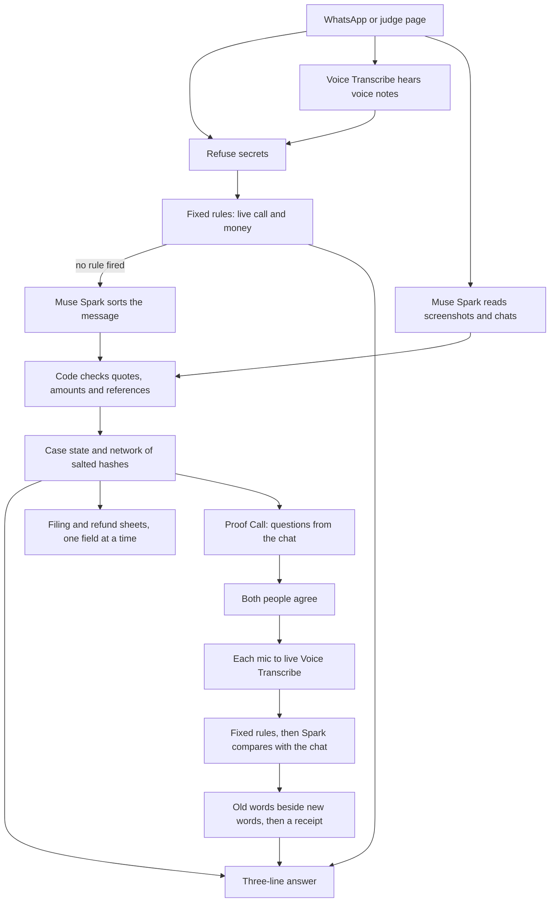

# Red Thread

The one contact you forward anything to, before you trust someone and after it goes wrong.

Now you know someone.

Work in progress for the Meta Global AI Developer Hackathon, Indie track, theme "Build for Your World". Everything in this repository is new work written during the event.

## What exists today

| Part | What it does |
|---|---|
| `redthread/portal_rules.py` | Checks text, files, IDs and amounts against the rules of India's cybercrime and refund portals |
| `redthread/conversation.py` | Reads Android and iPhone WhatsApp chat exports into numbered turns |
| `redthread/quotes.py` | Refuses any quote that is not word for word in the chat |
| `redthread/stages.py` | Reads a whole chat for the signs of a scam script. Muse Spark finds and quotes, code checks, fixed rules decide. |
| `redthread/model.py` | Calls Muse Spark with a spending cap, a cache and retries |
| `redthread/benchmark.py` | Compares detection approaches on a public benchmark |
| `redthread/amounts.py`, `facts.py` | Reads amounts the way people say them and checks a voice note against a payment screenshot |
| `redthread/shield.py` | Removes secrets before anything is kept, and blocks contact details and recovery offers between victims |
| `redthread/rules.py` | Fixed answers for a live call and for money signs, with no model and no waiting |
| `redthread/templates.py`, `reply.py` | The three-line answer in English, Hindi and Tamil, and the checks every answer must pass |
| `redthread/case.py`, `sheets.py` | Tracks a recovery case from forwarded messages and lays out each form field by field |
| `redthread/network.py` | Joins cases that share an account, number, link, image or script. Stores salted hashes only. |
| `redthread/engine.py` | The one contact. Everything a person sends comes here. |
| `redthread/world.py`, `demo.py` | A labelled simulation of a case from loss to credit, in plain text |
| `redthread/evals.py` | Plants errors on purpose and measures what the fixed rules catch |
| `redthread/senses.py` | Voice Transcribe hears voice notes. Muse Spark reads screenshots, catches what rules miss, fills filing details and translates. Code keeps only known kinds, real states and numbers the person gave. |
| `redthread/live.py` | The whole loop against the real models, with invented people and a hard spending cap |
| `redthread/evals_live.py` | Measures what Muse Spark adds behind the rules on unseen text, and tries to trick it |
| `redthread/audio.py` | Converts voice notes to WAV with ffmpeg, and only ever hands it real audio files |
| `redthread/whatsapp.py`, `channel.py` | WhatsApp Cloud API: checked webhooks, replies, buttons and media. Not yet connected to a live number. |
| `redthread/store.py` | Saves cases across restarts. The other person's chat is never saved, and "delete my data" removes everything. |
| `redthread/proof.py` | Proof Call: writes questions from a chat, checks every quote, drops questions Spark can guess blind, and compares answers. Never a verdict on a person. |
| `redthread/live_speech.py` | Live Voice Transcribe over its WebSocket, on the standard library |
| `redthread/proof_call.py` | One live call: consent first, each person's own mic, cards only for the person who forwarded the chat, a receipt at the end |
| `redthread/proof_demo.py` | An invented chat and a simulated person for the judge page |
| `redthread/proof_live.py` | Two whole calls against the real models, with invented voices, measuring each step |
| `redthread/server.py` | The webhook and the judge API, on the Python standard library |

## How it fits together



## Proof Call

A selfie proves a face. The call tests whether that face wrote the chat. Scam teams can split the work, with one team writing messages and a hired person on video. The person on camera may not know what "they" wrote.

- Muse Spark reads the whole chat once and writes small questions only the writer would know. Code checks each quote is word for word in the chat, and drops any question that gives away its answer. Spark then tries to bluff its own questions with no chat, and the ones it gets right are dropped.
- Both people are told an AI is on the call before anything starts. Nothing is heard until both agree.
- Each person's mic goes to live Voice Transcribe. Names from the chat are passed as keywords. Audio is not recorded, nothing about the call is written to disk, and no model sees faces.
- Fixed rules fire at once if someone asks for money or a code. Muse Spark then compares answers with the chat. The person who forwarded it sees old words beside new words, and decides for themselves.

It does not prove anyone is real or honest. A stand-in with notes can pass it, and answers fed live can beat it. It raises the cost of the scam.

## Run it

Python 3.10 or later. No packages needed yet.

```bash
python -m unittest discover -s tests -t .
```

The whole loop in plain text, with invented people and no key:

```bash
python -m redthread.demo
```

Planted errors, with no key:

```bash
python -m redthread.evals
```

The server, with `MODEL_API_KEY` set. With no key, it still answers from rules and templates:

```bash
python -m redthread.server
```

WhatsApp needs `WHATSAPP_TOKEN`, `WHATSAPP_PHONE_ID`, `WHATSAPP_APP_SECRET` and `WHATSAPP_VERIFY_TOKEN`. Voice notes need `ffmpeg`, which the `Dockerfile` installs. Call links need `REDTHREAD_PUBLIC_URL`.

Two whole calls against the real models, with a hard spending cap:

```bash
python -m redthread.proof_live --budget 1
```

## Results so far

Fixed rules only, on planted errors. No model is involved yet.

| Batch | Planted errors caught | Normal messages wrongly flagged |
|---|---|---|
| First batch, before any fixes | 51 of 80 | 6 of 39 |
| Second batch, unseen text, first run | 46 of 64 (72%) | 10 of 35 |

The second batch is the honest figure for text the rules have not seen. Both batches pass today, because the rules were fixed against them, so a pass now only guards against regressions.

Reading whole chats, on practice data only. The public benchmark is synthetic, and the last three sets are chats we generated with Muse Spark, so these numbers do not prove real-world accuracy.

| Set | Our pipeline | Spark, whole chat, plain prompt | Spark, message by message | Keywords, no model |
|---|---|---|---|---|
| Romance scams | 68 of 69 | 69 of 69 | 20 of 20 | 29 of 69 |
| Shopping scams | 75 of 75 | 75 of 75 | 20 of 20 | 29 of 75 |
| Tax scams | 81 of 81 | 81 of 81 | 20 of 20 | 73 of 81 |
| Scams without the obvious words | 19 of 20 | 20 of 20 | 20 of 20 | 6 of 20 |
| Romance scams cut before the money pitch | 0 of 20 | 3 of 20 | 10 of 20 | 1 of 20 |
| Normal chats wrongly flagged (benchmark) | 0 of 77 | 0 of 77 | 0 of 20 | 0 of 77 |
| Normal dating chats wrongly flagged | 0 of 20 | 0 of 20 | 1 of 20 | 2 of 20 |

Single messages, in English, Hindi, Tamil and mixes. On a small batch the rules had never seen, Muse Spark found far more than fixed rules. On the first run 4 Spark calls returned nothing because reasoning used up the output limit, which gave 15 of 17 for live pressure. After raising the limit:

| Test | Fixed rules | Muse Spark | Both |
|---|---|---|---|
| Someone under live pressure | 1 of 17 | 17 of 17 | 17 of 17 |
| Money already gone | 1 of 12 | 12 of 12 | 12 of 12 |
| Normal message wrongly called live | 0 of 14 | 0 of 14 | 0 of 14 |
| Normal message wrongly called a loss | 1 of 14 | 0 of 14 | 1 of 14 |

Fixed rules still answer first, because they are instant and work with no model. Muse Spark can raise an alarm they miss, and can never clear one. Seven attempts to trick the system passed on the final run, after one fix for a request that slipped past the off-topic check. These batches are small and invented by us.

Proof Call, on 16 invented chats with 80 questions. Spark played everyone, so this shows the idea is worth building, not how real people behave. No real person has tried it yet. Pass marks were fixed before the full run.

| Who answered | Fits the chat | Contradicts it | No clear answer |
|---|---|---|---|
| The person who wrote the chat | 99% | 1% | 0% |
| The writer, with some details forgotten | 64% | 4% | 32% |
| Stand-in with a 5-line cheat sheet | 61% | 35% | 4% |
| Stand-in with only name, job and city | 16% | 75% | 9% |

A cheat sheet scores about as well as an honest person who forgot things, which is the idea's main weakness. Rescoring the same answers with code checking first, then Muse Spark seeing the messages around each quote, gave 2 false contradictions in 80 writer answers, never 2 in one chat, while 2 or more answers differed in 15 of 16 chats for a stand-in with no notes and 8 of 16 for one with notes. We chose that measure after seeing results, so it is a lead, not a proven signal. A second scoring pass we tried showed no benefit, so we removed it.

One full call each with the writer and a stand-in, through real live speech and real Muse Spark, using invented voices on a chat we wrote: first words appeared a median of 1.2 seconds after speech began, and an answer card a median of 1.3 seconds after speech ended, 9.6 at worst. Answers settled by code are instant, and ones needing Muse Spark usually take 2 to 5 seconds. Mixed languages and calls between two real browsers are not tested yet.

Spark alone detects as well as our pipeline here. What the pipeline adds is proof: every quote is checked word for word against the chat before anyone sees it. It does not warn before the first request for money or details.

The benchmark needs the [public data](https://github.com/Offensive-AI-Lab/love-lies) in `~/muse-spike/benchmarks/love-lies`. Model arms need `MODEL_API_KEY` in the environment or in `~/muse-spike/.env`.

```bash
python -m redthread.benchmark --arms keyword,published --split all
```

## Credit

Benchmark data: Gressel et al., "Love, Lies, and Language Models: Investigating AI's Role in Romance-Baiting Scams", USENIX Security 2026, used under CC BY 4.0. We do not redistribute it here.
