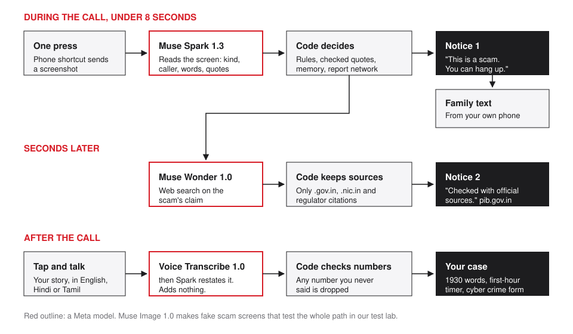
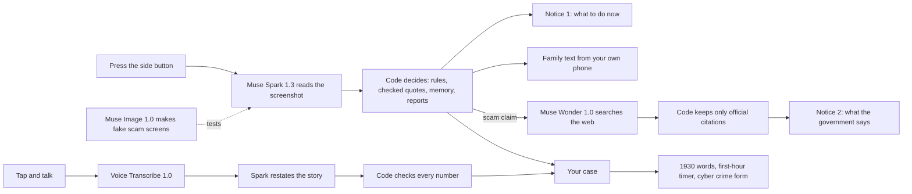

# Red Thread

**Press once. Know in seconds.**

On a call where someone says you are under arrest, in a chat that feels off, at a payment you don't trust: press the button on the side of your phone. Red Thread reads the screen and tells you what to do, without you leaving the call. Then it texts someone you trust, checks the scammer's claim against official sources, and turns what happened into a ready police complaint.

Live: https://red-thread-production.up.railway.app/press

Built for the Meta Global AI Developer Hackathon, Indie track, theme "Build for Your World". Everything in this repository was written during the event, Oct 27 to Nov 4, 2026, by Niranjan Thiyagarajan.

## Why

In India, "digital arrest" scams keep people on video calls for hours. Callers pose as police, CBI or customs, say the person's Aadhaar is in a money laundering case, and tell them not to hang up or tell anyone. People lose their savings because they can't step out of the call to check. Romance scams follow the same path in dating chats: trust, a reason to move apps, then a request for money.

Most help needs you to leave the moment: open an app, call a number, forward a chat. Red Thread works where the scam is happening, with one button.

## What one press does

| Moment | What happens | Who decides |
|---|---|---|
| During the call, under 8 s | The phone's shortcut sends a screenshot. Muse Spark 1.3 reads it: is it a call, a chat or a payment, who is calling, what they said. | Code decides the warning from fixed rules, quotes checked word for word, and earlier presses |
| Same moment | If it is a scam, the shortcut texts a person you chose, from your own phone: "I may be on a fake police call from 98765 43210 right now. Please call me." | Code writes the text. We never see who it goes to |
| Seconds later | Muse Wonder 1.0 searches the web on the scam's claim. A second notice says what the government says, with the source. | Code keeps only sentences that cite .gov.in, .nic.in or a regulator |
| A payment soon after | "Stop. Do not pay. At 21:37 you pressed on a fake police call." | Code, from memory of earlier presses |
| After the call | Your case page: the words to say on 1930 with the number and time filled in, a first-hour timer, and the cyber crime form filled from your own voice | Voice Transcribe 1.0 hears you, Spark restates it, code drops any number you never said |





## How we use Meta models

Every hosted Meta model has a real job, and each one sees only what it needs.

- **Muse Spark 1.3** reads screenshots with minimal reasoning effort, so a notice arrives in about 5 seconds. It returns structured fields and exact quotes. It never writes the warning. It also restates a victim's spoken story in plain English and fills the form fields, and on the dating side reads profiles, chats and bills.
- **Muse Wonder 1.0** checks the claim behind a scam against the web. The question is fixed for each kind of scam, so nothing from the person's screen is sent. One check serves everyone for a day.
- **Voice Transcribe 1.0** hears the victim's account in English, Hindi or Tamil, and powers the live voice features on the dating side.
- **Muse Image 1.0** attacks our own checks: it makes the fake call, chat, payment and bill screens our test lab runs against.
- **SAM 3.1** finds the QR code on a restaurant bill in the dating side's bill check.

The rule throughout: models write words, code supplies the facts. If a model is slow or fails, a fixed safety line goes out at once, and the demo never shows an error.

## Privacy

- Each screenshot goes to Meta's Model API to be read once. Red Thread never saves it.
- We keep the warning, the time and any scam number or UPI ID, only to fill your case. Codes and card numbers are removed first.
- Everything is deleted after 24 hours, or at once with Delete everything.
- The family text goes from your own phone, so we never see who you send it to.
- Reports shared between victims are stored as salted hashes, so people see a count, never who reported.
- Red Thread is a prototype. It is not the police, a bank or a government service. In danger, call 112. For cyber fraud in India, call 1930.

## Results

Small tests we built ourselves. They show the system works end to end, not real-world accuracy.

| Test | Result |
|---|---|
| Screen lab: 11 fake screens made with Muse Image (5 scams, 4 ordinary, 2 others) | 11 of 11 read as expected, 5 of 5 scams stopped, 0 false alarms, median 5.3 s, slowest 7.9 s |
| Bill lab: 10 bills, 7 with planted overcharges | 7 of 7 caught, 0 false alarms, QR found on 10 of 10 |
| Claim check, live | Notice 2 cited pib.gov.in; 13 to 20 s cold, under a second once kept |
| Automated tests | 794 passing |

Honest notes: the screen set is small and invented, and one rule (an arrest threat sent by message) was added after the lab missed it, so that screen is not a held-out test. On a public romance scam benchmark, a single plain Spark read did as well as our multi-step pipeline, so we do not claim better detection. What Red Thread adds is action in the moment: checked quotes, memory across presses, the family text, official sources and the recovery steps.

## Try it

1. Open https://red-thread-production.up.railway.app/press and use "Send a screenshot" with any screen. The test screens are in `redthread/web/static/press-*.jpg`.
2. On a phone, follow the shortcut recipe on that page and set it on the Action button or Back Tap.

## Run it

Python 3.12, standard library only. ffmpeg for voice notes in other formats.

```bash
python -m unittest discover -s tests -t .
```

The server, with `MODEL_API_KEY` set. With no key it still answers from rules and templates:

```bash
python -m redthread.server
```

The test lab against the real models, with a spending cap:

```bash
python -m redthread.lab screens
```

## Where things live

| Part | What it does |
|---|---|
| `redthread/press.py` | One press: reads the screen, decides the warning, remembers earlier presses, writes the family text, keeps nothing past a day |
| `redthread/claims.py` | The second layer: Wonder checks a scam's claim, code keeps only official citations |
| `redthread/aftercall.py` | The case after a call: 1930 words, first-hour timer, the filled form |
| `redthread/rules.py` | Fixed rules for live call pressure and money signs |
| `redthread/senses.py`, `audio.py` | Voice Transcribe and the story-to-form step |
| `redthread/sheets.py`, `portal_rules.py` | The cyber crime forms, field by field, checked against the portal's rules |
| `redthread/network.py` | Reports joined by salted hash |
| `redthread/lab.py` | The test lab, with screens made by Muse Image |
| `redthread/server.py` | The web app and API, on the Python standard library |
| `redthread/web/` | The pages. `/press` is One Press |

The dating side (a voice intro, the match thread, Proof Call and the bill check) lives in the same server at `/`, `/match` and `/proof`.

## Credit

Benchmark data: Gressel et al., "Love, Lies, and Language Models: Investigating AI's Role in Romance-Baiting Scams", USENIX Security 2026, used under CC BY 4.0. We do not redistribute it here.
